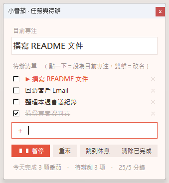

<p align="center">
  
</p>

# 小番茄 Tomato Timer

待在螢幕角落的桌面番茄鐘（Windows），附「目前專注任務」與簡單待辦清單。
純 Python + tkinter，無第三方執行時依賴；也可打包成單一 `.exe`。

## 畫面

<p align="center">
  <br>
  <sub>滑鼠移上去時展開：剩餘時間、狀態、今日番茄數與目前任務</sub>
</p>

<p align="center">
  <br>
  <sub>雙擊番茄開啟「任務與待辦」面板</sub>
</p>

## 功能

- 常駐螢幕角落、永遠置頂、背景透明；閒置時半透明，滑鼠移上去或有提示時才完整顯示
- 專注 / 休息自動輪替，環形進度條顯示進度，休息時番茄會變成散步小人
- 預設 25/5、45/10、50/10 分鐘，也可自訂（專注 1–180、休息 1–60 分鐘）
- 目前專注任務 + 待辦清單（新增、改名、勾選完成、刪除、清除已完成）
- 每日完成番茄數統計、提示音、四個角落快速定位、拖曳後記住位置
- 支援高 DPI 縮放、避開工作列

## 操作

| 動作 | 效果 |
| --- | --- |
| 單擊番茄 | 暫停 / 繼續 |
| 雙擊番茄 | 開啟「任務與待辦」面板 |
| 拖曳番茄 | 移動位置（會記住） |
| 右鍵番茄 | 選單：重新開始、跳過階段、時間設定、移到角落、提示音、結束 |

待辦面板：點一下項目 = 設為目前專注；雙擊 = 改名；`Esc` 關閉面板。

## 安裝

### 方式一：直接執行 Python 原始碼

需求：Windows 10/11、Python 3.9+（開發環境為 3.12，安裝時需勾選 tcl/tk）。

```powershell
git clone https://github.com/wetwilliam/tomato_timer.git
cd tomato_timer
pythonw tomato.pyw        # 無主控台視窗；除錯時可改用 python tomato.pyw
```

也可以直接雙擊 `tomato.pyw`。

### 方式二：打包成單一 exe

```powershell
pip install -r requirements.txt
python build.py
```

`build.py` 會先用 Pillow 重新產生 `tomato.ico`，再呼叫 PyInstaller，
輸出 `dist\小番茄.exe`（單檔、無主控台）。直接雙擊即可使用，不需安裝 Python。

### 開機自動啟動（選用）

按 `Win + R` 輸入 `shell:startup`，把 `小番茄.exe`（或 `tomato.pyw`）的捷徑放進去。

## 資料與設定

所有設定、待辦與統計存在 `%APPDATA%\TomatoTimer\data.json`。
刪除此檔即可還原預設值。

## 專案結構

```
tomato.pyw        主程式（計時器與待辦面板）
build.py          產生圖示並以 PyInstaller 打包
tomato.ico        應用程式圖示（由 build.py 產生）
assets/           README 用的圖示與截圖
requirements.txt  打包所需套件
```

## 注意

- 僅支援 Windows（使用 `ctypes.windll`、tkinter 的 `-transparentcolor`、`winsound`）；
  其他平台無法正常顯示透明視窗。
- 未簽章的 exe 可能被 SmartScreen 或防毒軟體提示，屬 PyInstaller 單檔常見現象。
